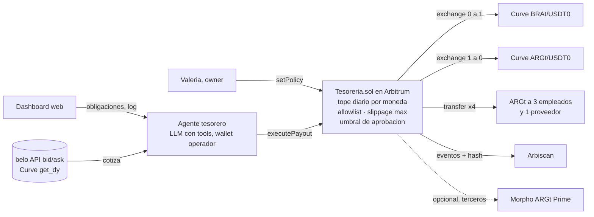

# Idea: Tesorero Regional – la pyme cobra en reales y paga en pesos, sin pasar por dólares

> *"A Tesorero con Correa le ponemos la moneda de verdad: el agente cobra en BRAt, convierte y paga en ARGt en la misma transacción, dentro de los topes que fija el contrato."*

Propuesta para el **track Stablecoins (Twin)**. Sigue la plantilla de `docs/BRAINSTORMING.md`, se apoya en `docs/ideas/final/PLAN_TESORERO.md` (la columna vertebral es la misma) y se compara con **Fiado** (PR #4) y **Mandato** (`final/DECISION_TRACKS.md`). Lo que no verifiqué va marcado **[SIN VERIFICAR]**; lo que sí, dice cómo.

## Por qué la traigo, en 5 líneas

1. El plan vigente (`PLAN_TESORERO.md`) va **solo a Blockchain, todo en Fuji con un mock de ARGt**. Eso deja afuera el track de Twin (500 USDT y el jurado Twin, belo y Tether), que exige un token Twin **real** en una chain elegible y un hash real.
2. El juez de la ronda 3 le marcó a Mandato que "ARGt es reemplazable". A Tesorero con Correa le pasa lo mismo: con USDC funciona igual. Acá no: el producto **es** tener reales y pesos como tokens y convertir entre ellos. Sin moneda local onchain no existe.
3. Es la **misma columna vertebral** que ya está repartida entre P1, P2 y P3 (contrato con política, agente que propone, aprobación humana). Suma un módulo de FX y cambia la chain del deploy para Twin. No tira trabajo.
4. Verifiqué hoy a las 10:00, por RPC, los pools de Curve, sus firmas y su liquidez, y que ARGt no tiene `permit`. Los datos están abajo para que nadie pierda la primera hora.
5. La pregunta de fondo es una sola: **¿vamos solo a Blockchain o cubrimos Twin con un segundo deploy?** Al final hay tres opciones y mi recomendación.

## La idea en una línea

Una tesorería programable en moneda local para empresas que **cobran en una moneda de LatAm y pagan en otra**: un contrato guarda los tokens Twin y las reglas (tope diario por moneda, lista de destinatarios, slippage máximo, umbral de aprobación), y un agente de IA cotiza con belo y Curve, convierte por los pools y paga nómina y proveedores. Combina las consignas 1 (pagos agénticos con límites) y 3 (FX y cobertura cambiaria) del PDF de Twin.

## Plantilla

- **Problema:**
  - Una software factory, agencia o startup argentina que factura a un cliente en Brasil, paga sueldos en Argentina y un proveedor en México necesita dos o tres bancos, un broker de cambio y una planilla que alguien revisa a mano los viernes.
  - Cada tramo cuesta entre 2 % y 4 % de spread y tarda de 1 a 3 días [SIN VERIFICAR: tarifas 2026 de Deel, Payoneer y bancos].
  - Delegarlo en un agente hoy es darle la clave del banco: el mismo dolor que describe Tesorero con Correa, pero con tres monedas en vez de una.
  - Las empresas de los propios jurados (Digital House, belo, Twin) operan en varios países de la región.
- **Usuario:** Valeria, administradora de una software factory de 25 personas en Buenos Aires [persona inventada]. Cobra en reales a un cliente de San Pablo, paga 20 sueldos en pesos el día 30 y a un diseñador en Guadalajara el 15.
- **Solución:**
  - La empresa tiene **BRAt, ARGt y MEXt como tokens** en un contrato propio. No hay cuenta en dólares en el medio.
  - El contrato impone las reglas: tope diario por moneda, lista blanca de destinatarios, slippage máximo contra el mid de belo, umbral por encima del cual aprueba Valeria desde el celular.
  - El agente lee las obligaciones, cotiza (API pública de belo y `get_dy` de los pools), decide cuándo convertir, ejecuta `executePayout` y **explica cada movimiento** (lo que pide belo en su consigna 4).
  - Una sola transacción hace los dos swaps (BRAt → USDT0 → ARGt) y los pagos a los destinatarios.
- **Demo (lo que se ve a las 18:00):**
  1. Estado inicial: la tesorería tiene 1.000 BRAt (cobro de San Pablo). Políticas visibles en pantalla.
  2. El agente razona en vivo: compara belo (BRAt/ARGt) con `get_dy` de los dos pools, calcula el costo total y decide convertir hoy. El log muestra por qué.
  3. Transacción real en Arbitrum: hash, link a Arbiscan, los 4 destinatarios con ARGt acreditado.
  4. Un mail trucho pide pagar a una dirección fuera de la lista: el contrato revierte con `DestinatarioNoPermitido` y el agente lo reporta. Un pago mayor al umbral queda en amarillo hasta que Valeria aprueba.
  5. Cierre con el costo de hoy contra el costo bancario y el siguiente paso (Morpho para saldos ociosos, más monedas, bridge).
- **On-chain (por qué hace falta la cadena):**
  - La empresa **tiene** moneda local como token, sin un custodio que convierta a dólares en el medio. Eso no existe fuera de la cadena para una pyme.
  - El FX se ejecuta en pools públicos con precio verificable, **en la misma transacción** que el pago. Nadie puede "dibujar" el tipo de cambio.
  - Las reglas las impone el contrato, no una política interna del software. El operador (el agente) tiene poderes acotados y revocables.
  - Es componible: el mismo contrato puede depositar en Morpho o usar el bridge de LayerZero sin pedir permiso.
- **Riesgo:** ver la sección "Riesgos, dichos de frente".

## Por qué tiene que ser moneda local (el argumento para Twin)

- Con USDT la empresa tiene dólares y convierte en cada pago: eso ya lo hacen Deel y Payoneer, y es lo que Twin llama "orquestar". Lo que Twin vende es **sacar el paso de conversión**: la plataforma cobra, paga y liquida en la moneda que el usuario ya usa. Este producto es exactamente eso.
- Responde al criterio **Idea** ("solo posible con moneda local onchain, token como núcleo"): si sacás los tokens Twin no queda un producto peor, no queda producto.
- Twin, en su propio artículo "Issuer, Orchestrator or Rails", prioriza **payouts locales, nómina y settlement** para plataformas que operan en pesos, reales o pesos colombianos. Es este caso.
- **Nota regulatoria:** la CNV frenó la oferta de ARGt en marzo de 2026 por el rewards de belo y, según el doc de Fiado, levantó la sanción en abril cuando se quitaron las referencias a rendimiento [SIN VERIFICAR por mí; fuente en `fiado/FIADO.md`]. Esto es B2B de pagos y tesorería, sin promesa de rendimiento. Morpho queda como "siguiente paso" y con aviso de riesgo de terceros, nunca como gancho del pitch.

## Cómo cumple cada track

### Twin (Stablecoins)

| Criterio | Cómo lo cubre |
|---|---|
| Idea | Multi-moneda y FX en la misma tx: imposible sin tokens Twin componibles con Curve. Combina las consignas 1 y 3 |
| Problema | Usuario con nombre, dolor con número (spread, días, trabajo manual), jurado que lo vive en sus empresas |
| Negocio | 25 a 50 puntos básicos por conversión y pago (contra 200 a 400 de un banco) [SIN VERIFICAR: precio] + abono mensual por agente. Canal: integradores de Twin (belo), estudios contables, software factories con equipos en 2 o más países |
| Pitch | Demo con hash real y un revert que demuestra la tesis en 10 segundos |

Requisitos: token Twin real en chain elegible (**Arbitrum**, donde están los pools) y hash verificable. README con tokens, chain y direcciones. Commits durante el evento.

### Avalanche (Blockchain)

**Sola, no cumple.** Curve y Morpho están solo en Arbitrum, el bridge de ARGt no llega a Avalanche y en C-Chain hay 1.770 ARGt en circulación (coincide con lo que midió Facundo) y los otros seis tokens tienen supply cero. Para Blockchain sigue valiendo Tesorero con Correa en Fuji tal como está planeado. La forma de unirlas es el **mismo contrato base** (`TesoreroConCorrea`) con un módulo `RutaFX` que solo se activa en el deploy de Arbitrum. Ver "Tres formas de usarla".

## Datos verificados hoy (10:00, por RPC público de Arbitrum)

### Pools de Curve (Arbitrum)

| Pool | coin 0 / coin 1 | Liquidez aprox. | 1 token → USDT0 | `price_oracle()` |
|---|---|---|---|---|
| ARGt/USDT0 | ARGt (18 dec) / USDT0 (6 dec) | 24,5 M ARGt + 14,8 k USDT0 ≈ US$ 30 k | 0,000601 | 1.658 ARS por USD |
| BRAt/USDT0 | BRAt / USDT0 | 83 k BRAt + 9,3 k USDT0 ≈ US$ 24 k | 0,181 | 5,49 BRL por USD |
| MEXt/USDT0 | MEXt / USDT0 | 55 k MEXt + 1,1 k USDT0 ≈ US$ 4 k | 0,0537 | 18,45 MXN por USD |
| COLt/USDT0 | COLt / USDT0 | 9,4 M COLt + 1,4 k USDT0 ≈ US$ 4 k | 0,000308 | 3.218 COP por USD |

- Son pools **twocrypto-ng** (`A() = 100000`, `gamma() = 1e14`). La firma correcta es `get_dy(uint256 i, uint256 j, uint256 dx)` y `exchange(uint256 i, uint256 j, uint256 dx, uint256 min_dy)`. La variante `int128` de StableSwap no responde.
- En los cuatro pools, **coin 0 es el token Twin y coin 1 es USDT0**. Fee 0,3 % por hop (`fee() = 30000000`); dos hops ≈ 0,6 % más spread. Para la demo, montos menores a US$ 20 por swap: slippage despreciable.
- USDT0 en Arbitrum: `0xFd086bC7CD5C481DCC9C85ebE478A1C0b69FCbb9` (6 decimales). Convertir bien antes de calcular `min_dy`.
- PERt, CHLt y BOLt no los medí. Asumir liquidez igual o menor a MEXt y no depender de ellos en la demo.

### Token ARGt (implementación detrás del beacon proxy, Arbitrum)

- Beacon `0xa92426af…8f32`, implementación `0xd9eff713…718e`. **Sin `permit` (ERC-2612) y sin `transferWithAuthorization` (EIP-3009).** El agente necesita una wallet con ETH para gas o una smart account ERC-4337. No sirve el flujo "firmá y listo" ni el facilitador x402 estándar, que usa EIP-3009.
- Tiene `paused()` y `mint` restringido. Las transferencias son permissionless. 18 decimales (resuelve el [SIN VERIFICAR] de `PLAN_TESORERO.md` §3).
- Supply en Arbitrum: 16.100 millones de ARGt (≈ US$ 9,7 M).
- La misma dirección es un token distinto en otra chain (`0x5986…2214` es ARGt en Arbitrum y Ethereum, MEXt en Base y BRAt en Polygon). Guardar siempre el par (chain, dirección).

### Direcciones (Arbitrum, del PDF de Twin)

| Qué | Dirección |
|---|---|
| ARGt | `0x59863989d080B22476DB95656d0C3CC18be92214` |
| BRAt | `0xC4ed6Aba5373D78E160F4df39e011F078Be54df8` |
| MEXt | `0xb96aA6babCcD738d6644ADd4912fE5eFbEBF5a25` |
| Pool ARGt/USDT0 | `0x356d349da9add7efb56a35fab939a2c6d852f853` |
| Pool BRAt/USDT0 | `0xeef48df5f1c509cd9730774b4e8a4464626ef8d5` |
| Pool MEXt/USDT0 | `0x6edbf3ada7b6d9524c3248955538d573aae449cf` |
| Vault Morpho ARGt Prime | `0x9Dd3F844747AB78d616BF76DB92756E17A064aDD` |

### API de precios de belo

`GET https://api.belo.app/public/price` devuelve 122 pares con `pairCode`, `bid`, `ask` y `spread`. **No hay `mid`**: calcular (bid + ask) / 2. Pares útiles: `USDT/ARS` (hoy bid 1.635 / ask 1.650), `BRAt/ARGt`, `MEXt/ARGt`, `BRL/ARS`. Comparar el mid de belo con `get_dy` es el chequeo de slippage del agente.

## Arquitectura



Una sola transacción del agente dispara los dos swaps y los pagos. El agente no toca los fondos: solo puede llamar a una función que el contrato valida contra las políticas del owner. Las cotizaciones son lecturas; si belo y Curve difieren más que el slippage permitido, el agente no ejecuta y lo explica.

## Contrato (borrador: `Tesoreria.sol`, ~120 líneas sobre `TesoreroConCorrea`)

```solidity
interface ICurveTwocrypto {
    function get_dy(uint256 i, uint256 j, uint256 dx) external view returns (uint256);
    function exchange(uint256 i, uint256 j, uint256 dx, uint256 min_dy) external returns (uint256);
}

struct Policy { uint256 dailyCap; uint256 spentToday; uint256 day; uint16 maxSlippageBps; }

mapping(address => Policy)  public policyOf;     // por token de salida
mapping(address => bool)    public allowedPayee;
mapping(address => address) public poolOf;       // token Twin -> pool Curve (coin0 = token, coin1 = USDT0)
address public owner;     // Valeria: setPolicy, setPayee, setOperator, pause, withdraw, aprobar
address public operator;  // wallet del agente: solo executePayout
uint256 public umbral;    // por encima, queda PendienteAprobacion (igual que en TesoreroConCorrea)

function executePayout(
    address tokenIn, address tokenOut, uint256 amountIn, uint256 minOut,
    address[] calldata payees, uint256[] calldata amounts, bytes32 facturaId
) external onlyOperator whenNotPaused {
    // 1. swap tokenIn -> USDT0 en poolOf[tokenIn]   (exchange(0, 1, amountIn, 0))
    // 2. swap USDT0 -> tokenOut en poolOf[tokenOut] (exchange(1, 0, usdt, minOut))
    // 3. require: sum(amounts) <= recibido y <= cap del dia; cada payee en allowlist; facturaId nueva
    // 4. si sum(amounts) > umbral: guardar pendiente y emitir PendienteAprobacion; si no, transferir
    // 5. emit Payout(facturaId, tokenIn, tokenOut, amountIn, recibido, payees)
}
```

Notas: aprobar USDT0 al pool de salida desde el contrato antes del segundo swap. `min_dy` = `get_dy` × (1 − slippage). En Fuji el módulo FX queda apagado (`poolOf` vacío) y el contrato se comporta como `TesoreroConCorrea`. En Arbitrum no hay gate KUMPLY (su store es de Fuji): el gate es la allowlist del owner.

## Comparación honesta

| | Tesorero con Correa (plan vigente) | **Tesorero Regional** | Fiado (PR #4) | Mandato |
|---|---|---|---|---|
| Track principal | Blockchain (Fuji) | **Twin (Arbitrum)** | Dual | Dual |
| Twin: "token núcleo" | Débil: con USDC funciona igual | **Fuerte**: sin tokens Twin componibles no hay producto | Fuerte: deuda y ventas en la misma moneda | Débil (lo marcó el juez de ronda 3) |
| Twin: originalidad | Pagos agénticos (consigna 1): varios equipos la van a hacer | Consignas 1 + 3 juntas; FX en la misma tx del pago | Crédito con repago por venta (consigna 2) | Consigna 1 |
| Twin: problema y usuario | Pyme con 30 proveedores | Empresa con equipo o clientes en 2 o más países; el jurado lo vive | Almacén sin crédito | Diego y Nelly (flojo según EVAL) |
| Avalanche: cumple sola | Sí | **No** (pools y vaults en Arbitrum) | Sí | Sí |
| KUMPLY / 0xGasless | Combo +20 natural | Solo en el deploy de Fuji | Natural | Natural |
| Wow de demo | Agente engañado, contrato frena | Dos monedas en una tx + revert por política | Deuda que baja con cada venta | Agente engañado |
| Riesgo técnico | MEDIO | MEDIO: dos hops de Curve + decimales 6/18; sin KUMPLY en Arbitrum | MEDIO-BAJO | MEDIO-ALTO |
| Horas extra sobre el plan vigente | 0 | **2,5 a 3 h de una persona** (si se usa como módulo) | Cambio de idea completo | Reemplazada |

## Tres formas de usarla (lo que hay que decidir)

**A. Módulo Twin del plan vigente** (mi recomendación si la organización permite dos tracks). Tesorero con Correa sigue igual en Fuji. A partir de las 14:00, si el punta a punta del PLAN está verde, una persona (P4 o quien se libere) hace el deploy en Arbitrum del mismo contrato con `RutaFX`, con BRAt y ARGt reales de los mentores, y ejecuta **una** transacción BRAt → ARGt → 2 destinatarios. Va al README como "deploy para el track Stablecoins" con el hash. Costo: 2,5 a 3 h de una persona. Riesgo: P4 ya está cargado (sponsors, README, pitch, video).

**B. Idea principal, solo Twin.** Si la organización dice que un proyecto va a un solo track y el equipo prefiere Twin (jurado que puntúa idea, problema, negocio y pitch, con un solo requisito técnico: una tx real). Cronograma abajo. Se pierde el combo KUMPLY + 0xGasless.

**C. No hacerla.** Queda como documento y como respuesta lista para la pregunta del jurado de Twin "¿y por qué ARGt y no USDC?".

**Lo que hay que preguntar ya, sea cual sea la opción:**
1. A la organización: ¿un mismo proyecto puede competir en Twin y en Blockchain? Sigue [SIN CONFIRMAR] en todos los docs del equipo.
2. A los mentores de Twin: BRAt y ARGt **en Arbitrum** para dos o tres wallets, y si aceptan que el deploy de Twin sea en Arbitrum (está en su lista de chains elegibles).
3. ¿Quién tiene 2,5 h libres desde las 14:00?

## Cronograma si se elige B (adaptado a los cortes del PLAN_TESORERO)

| Hora | Hito | Si no se cumple |
|---|---|---|
| 10:30 – 11:00 | Decisión, roles, pedido a mentores (BRAt + ARGt en Arbitrum, US$ 5 de ETH). Estructura `contracts/`, `agent/`, `web/` | — |
| 11:00 – 12:30 | P1: `Tesoreria.sol` con test de happy path y deploy verificado en Arbitrum. P2: tools `get_quotes`, `get_obligations`, `execute_payout` en simulación. P3: dashboard con balances y políticas. P4: README y guion v0 | 12:45: sin contrato, el agente ejecuta swaps y transfers directo con viem y la política se valida en el backend |
| 12:30 – 14:30 | Integración: agente → contrato con montos chicos. **Primer hash con los dos swaps y los pagos** | 14:30 sin hash: se corta el segundo hop; se paga en la misma moneda que se cobró |
| 14:30 – 16:00 | Revert por política en vivo, log explicable, links al explorer, video de respaldo, README completo | — |
| 15:30 | **FREEZE** de features | — |
| 16:00 – 17:30 | 6 slides, tres ensayos con cronómetro, preguntas del jurado | — |
| 17:45 | **ENTREGA** | — |

## Riesgos, dichos de frente

1. **Dos chains si vamos a los dos tracks.** KUMPLY y 0xGasless viven en Fuji; los tokens Twin y los pools en Arbitrum. La única forma honesta es dos deploys del mismo contrato. Se dice en el README.
2. **ARGt no tiene `permit` ni EIP-3009.** El operador necesita ETH en Arbitrum (centavos) o una smart account. Que 0xGasless funcione en Arbitrum está [SIN VERIFICAR]; en su quickstart solo aparecen Fuji y Avalanche mainnet.
3. **Liquidez chica.** Entre US$ 4 k y US$ 30 k por pool. Para la demo sobra; para el pitch, el modelo escala con market makers y los propios emisores. El agente nunca ejecuta si el pool se aleja del mid de belo más que el slippage permitido.
4. **Decimales.** USDT0 tiene 6 y los tokens Twin 18. Es el bug más probable del día.
5. **"Esto es Deel onchain".** Respuesta: Deel convierte a dólares en el medio y cobra por eso; acá la empresa tiene la moneda local, el FX pasa por un pool público y las reglas las impone un contrato que la empresa controla.
6. **Tokens de prueba y gas.** Pedir el doble. RPC público con rate limit: usar un endpoint con API key.

## Pitch de 3 minutos y preguntas del jurado

- **0:00** "Una software factory de Buenos Aires cobra en reales y paga en pesos y pesos mexicanos. Hoy eso cuesta 3 % y tres días." Nombrar a Valeria.
- **0:30** Por qué ahora: el real y el peso ya son ERC-20 que cualquier contrato puede mover. Lo que faltaba era la tesorería.
- **0:50** Demo en vivo: el agente decide, ejecuta, hash en pantalla, el revert por política, el amarillo que aprueba Valeria.
- **2:10** Qué solo es posible onchain: reglas en el contrato, FX con precio público, operador revocable.
- **2:30** Negocio: puntos básicos por operación más abono; primeros clientes: software factories y agencias con equipos en 2 o más países; distribución vía integradores de Twin.
- **2:50** Cierre: "El agente se puede equivocar. La tesorería, no."

| Pregunta probable | Respuesta |
|---|---|
| ¿Esto no es Deel o Payoneer onchain? | Convierten a dólares en el medio y cobran por eso. Acá la empresa tiene la moneda local, el FX pasa por un pool público con precio verificable y las reglas las impone un contrato suyo. Y es componible con Morpho y el bridge |
| ¿Y la regulación, lo de la CNV? | B2B de pagos y tesorería, sin promesa de rendimiento. No custodiamos: el contrato es de la empresa. El on y off-ramp lo hacen los integradores de Twin con su compliance |
| ¿Con qué liquidez? | Hoy US$ 4 k a 30 k por pool; para nómina de una pyme alcanza. Escala con market makers y emisores. El agente no ejecuta fuera del slippage permitido |
| ¿Quién paga el gas? | La wallet operadora, con centavos de ETH. Después, smart accounts con paymaster |
| ¿Y si el agente se equivoca o lo hackean? | Solo puede llamar a una función, con topes, allowlist y slippage máximo. El owner lo revoca o pausa en una tx. Cada pago queda en el explorer |

## Referencias: qué ganó en otros hackathons y qué se hace en otros países

- **HackMoney 2026, track Arc de Circle** ([arc.io](https://www.arc.io/blog/meet-the-arc-track-winners-from-the-hackmoney-2026-hackathon-and-what-we-learned)): ganaron ArcFlow (tesorería de nómina que pone fondos ociosos a rendir antes de pagar), arctan (DEX de FX multichain), Text-to-Chain y Versus. El 97 % de los 155 proyectos tenía agentes; los que destacaron escondieron el gas y resolvieron flujos conocidos: nómina, contratistas, escrow.
- **Global Stablecoin Hackathon de Mento y Celo** ([paragraph](https://paragraph.com/@papajams.eth/global-stablecoin-hackathon)), monedas locales en MiniPay: Digipaga (pago de servicios en México, dos premios), Esusu (círculos de ahorro), 3 Wheeler Bike Club (fondo común para choferes de tuk-tuk). Lección: digitalizar comportamientos existentes para una comunidad concreta, onboarding sin pedir wallet al entrar.
- **ETHGlobal Buenos Aires** ([resumen](https://www.weex.com/news/detail/quick-look-at-the-top-10-winning-projects-from-the-ethglobal-buenos-aires-hackathon-241705)): Paybot (micropagos en stablecoin, el proveedor paga el gas), Payload Exchange (comercios aceptan cualquier token vía agentes x402), Hubble (agentes que se pagan entre sí con x402 y ERC-8004).
- **Consensus Miami 2026** ([kucoin](https://www.kucoin.com/news/flash/ai-agents-drive-startup-surge-at-consensus-miami-easya-hackathon)): Dairy Price API, API que cobra por llamada a agentes vía x402. Ya está en `ronda-1/s6` como idea saturada.
- **Singapur, Project Orchid (MAS):** "purpose-bound money", dinero local con condiciones de uso incorporadas. El marco conceptual más cercano a "políticas en el contrato".
- **Brasil:** Pix Automático para cobros recurrentes, pilotos de Drex con escrow programable, anticipación de recibíveis (la versión bancaria de la consigna 2 y de Fiado).
- **México:** MXNB de Bitso y Juno como peso onchain. **Europa:** Monerium emite euros onchain con IBAN propio, el modelo al que apunta Twin con sus integradores.
- **Twin, "Issuer, Orchestrator or Rails"** ([twin.finance](https://www.twin.finance/article/issuer-orchestrator-or-rails-stablecoins-latam)): los casos que ellos priorizan son payouts locales, nómina y settlement. Esta idea cae ahí.
- Fuentes técnicas: [listado de Twin en DefiLlama](https://github.com/DefiLlama/peggedassets-server/pull/964) (direcciones por chain y supply), [resolución de la CNV, marzo 2026](https://news.bitcoin.com/argentine-securities-regulator-blocks-peso-stablecoin-operations/), [quickstart de 0xGasless](https://docs.0xgasless.com/core/getting-started/quickstart), [whitepaper de Twin](https://assets.twin.finance/docs/TwinStablecoins_Whitepaper_v1.pdf).

## Reparto sugerido (si se elige B)

- **P1:** `Tesoreria.sol` + test + deploy verificado en Arbitrum (hash de prueba a las 12:30).
- **P2:** agente con tools (belo, `get_dy`, obligaciones, `execute_payout`) y log explicable.
- **P3:** dashboard: políticas, balances, bandeja de pagos, semáforo, links a Arbiscan.
- **P4:** mentores de Twin (tokens y ETH), README (tokens, chain, direcciones, hashes), pitch, video a las 16:30.

**Corte:** si a las 14:30 no hay hash con los dos swaps, se paga en la misma moneda que se cobró y el FX va como "siguiente paso".
